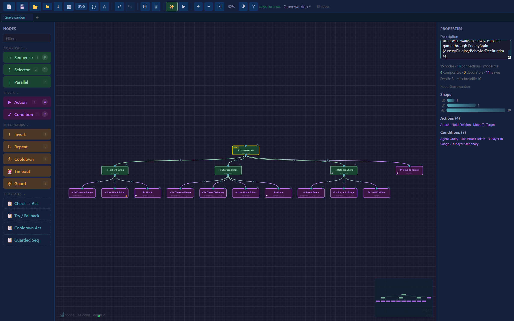
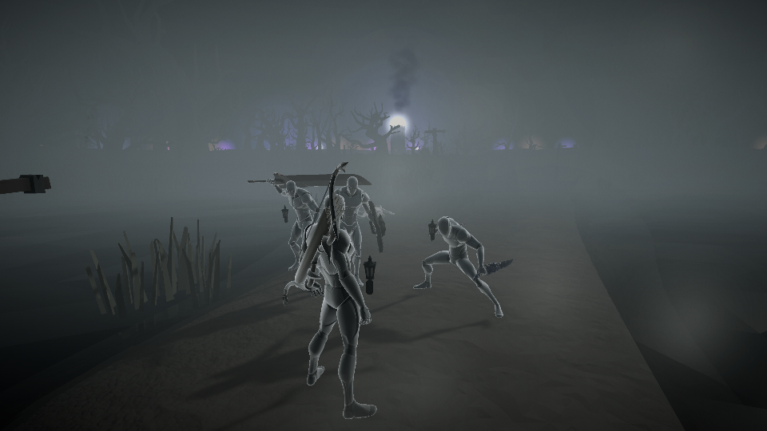
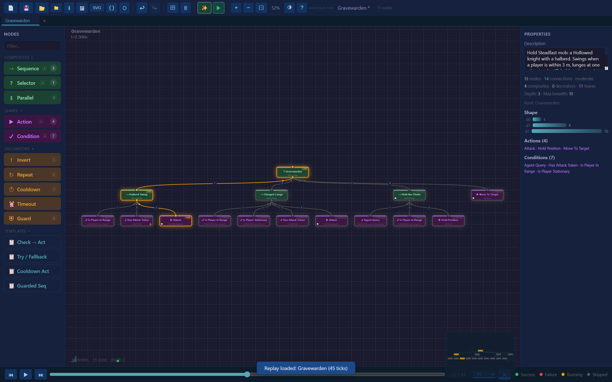

# Behavior Tree Editor

**Used to build the enemy AI in Hold Steadfast**, a co-op horde-defense game made in Unity. The Gravewarden, a
halberd-wielding blocker, plays a tree designed in this editor. Twelve more of its enemy trees open here too (all but
one, which uses a node type the editor doesn't have yet), and a test in the game proves each one makes exactly the
decisions the game's original runtime makes.

| 1 · Design | 2 · Play | 3 · Replay |
|---|---|---|
|  |  |  |
| Branches named and laid out in the editor, saved straight into the Unity project's `Assets/`. | The enemy runs the `.bt.json`. Save again in Play mode and it switches trees within a second. | The game records every tick; drop the `.replay.json` on the editor to see why it swung. |

A visual node-graph editor for game AI: author behavior trees, debug them with a replay timeline, and run them in
Unity through a small C# runtime. Desktop app (Tauri) for Windows, or the same editor in the browser
([live demo](https://hansvidaure24.github.io/Behavior-Tree-Editor/editor/)).

## The workflow

1. **Design** the tree in the editor. Leaves are named for game code (`Move To Target`, `Attack`) and carry
   parameters (`stop_distance: 2.5`, `attack: 1`).
2. **Save** with Ctrl+S. The desktop app writes `gravewarden.bt.json` (logic) and `gravewarden.bt.layout.json`
   (positions) directly into the Unity project.
3. **Play.** The runtime binds each leaf to code by name. In the Editor it watches the file, so saving in the editor
   updates enemies that are already fighting, with Unity left in the background.
4. **Replay.** `TickRecorder` captures what the tree did each tick (and the blackboard). The editor scrubs through it
   on the same tree, with heatmaps and per-node timelines.

## Getting started

**Desktop app** (needs Node, Rust, the Visual Studio C++ build tools, and the WebView2 runtime that ships with Windows):

```bash
npm install
npm run tauri build
```

This produces `src-tauri/target/release/bt-editor.exe` and an NSIS installer in `src-tauri/target/release/bundle/nsis/`.
For development, run `npm run tauri dev`.

**Browser:** open the [live demo](https://hansvidaure24.github.io/Behavior-Tree-Editor/editor/), or serve `editor/` with any
static server. No build step is needed there; the editor is plain ES modules.

**Unity:** copy [`adapters/unity`](adapters/unity) into `Assets/Plugins/`, add *Behavior Tree Runner* to an agent, and
bind its actions. *Export → Unity C# Adapter* generates the bindings component for a tree. Details:
[adapters/unity/README.md](adapters/unity/README.md).

<details>
<summary><b>Features</b></summary>

- **Visual node-graph editor**: drag, connect, multi-select, auto-layout, minimap, tabs, outline, command palette,
  50+ keyboard shortcuts
- **Replay debugger**: load recorded ticks, scrub back in time, heatmap overlay, flow particles, blackboard viewer,
  per-node status timeline
- **Desktop app**: native open/save dialogs, files linked to tabs, outside changes reloaded, atomic writes an engine
  can watch safely
- **Unity runtime**: selector/sequence/parallel, invert/repeat/cooldown/timeout/guard, name-based bindings with node
  parameters, committed (non-interruptible) actions, debug logging, hot reload, tick recording
- **Git-friendly serialization**: logic and layout stored separately, so diffs make sense
- **Cross-engine export**: JSON plus runtime adapters for Unity (C#), Unreal (C++), Godot (GDScript)
- **Validation** in the editor and as a CLI for CI (`python validate.py examples/`)
- **AI-assisted authoring**: describe behavior in plain English via local [Ollama](https://ollama.ai), or fall back to
  fuzzy template search and built-in patterns
- **PWA**: the browser build works offline

</details>

## Examples

[`examples/holdsteadfast/`](examples/holdsteadfast) holds Hold Steadfast's enemy trees, from the Gravewarden (with
its layout and an in-game replay) to the 39-node Pale Warden boss. The empty canvas offers them first.
[`examples/`](examples) has generic trees (guard patrol, stealth assassin, shield wall, ...).

## What was hard

**Making the Unity runtime behave exactly like the game's own.** Hold Steadfast already had a behavior tree runtime
with careful semantics:
- Selectors pre-empt (and abort) lower branches.
- Sequences re-check their conditions while an action runs, but don't re-run finished actions.
- Attacks are committed: once started, the tree never interrupts them.

The first adapter got all of this subtly wrong and failed silently: unbound actions "succeeded" and guards ignored their
parameters. The rewrite matches those semantics, and the integration keeps the game's own leaf nodes. A test then runs
every game tree through both runtimes against the same scripted world for thousands of ticks, with staggers included,
and diffs every command the enemy gives. A deliberately changed tree fails the test at tick 83. That test is the reason
"behaves as designed" is a claim and not a hope.

**Hot reload without lying.** Unity re-imports a changed asset only when its window regains focus, and a file being
written can be read half-finished. The editor writes through a temp file and a rename. The runtime reads the file
itself, and only once it has stopped changing. A broken file is reported and the running tree keeps going.

**The replay debugger.** Statuses are only meaningful against the exact tree that produced them. The recorder keys
every tick by node id, and marks nodes that didn't run as *skipped* rather than leaving last tick's status behind. The
editor overlays each tick, a visit heatmap and per-node timelines on the live canvas while you scrub.

**Canvas performance.** Everything draws in one `requestAnimationFrame` loop on a HiDPI-scaled canvas:
- nodes and connections outside the viewport are culled;
- the minimap redraws every third frame;
- per-frame bookkeeping (who has a parent, what is collapsed) is O(n), not O(n²).

That is what lets the editor simply redraw everything every frame, replay overlays and particles included, instead
of tracking what changed.

## Architecture decisions

- **Vanilla JS, no framework.** The editor is about 10k lines of ES modules with JSDoc types, checked by
  `tsc --checkJs`. With no framework there is no build step for the web version, no dependency churn, and nothing between
  the code and the canvas. Vite only bundles it for the desktop app.
- **Canvas, not DOM/SVG.** A tree is hundreds of moving shapes and curves, plus replay heat, particles and
  animations, redrawn every frame. One canvas with culling is cheaper and simpler than reconciling a DOM node per shape,
  and hit-testing is straightforward geometry.
- **Tauri, not Electron.** It uses the WebView2 runtime already on Windows instead of shipping Chromium: the app is a
  9 MB exe and a 2.5 MB installer. The Rust side adds only what a browser can't do (native dialogs, writing anywhere
  the user picks, file watching), so the same frontend still runs as a web page.
- **Trees are data.** `.bt.json` holds logic only and `.bt.layout.json` holds positions, so moving a node never
  shows up as a logic diff. Runtimes interpret the data; leaves bind to game code by name, and the parameters on a
  node reach that code.

## Project layout

| Path | What |
|---|---|
| `editor/` | The editor (ES modules; `app.js` wires `canvas`, `panels`, `dialogs`, `file-io`, `toolbar`, ...) |
| `src-tauri/` | Desktop shell (Tauri v2): window, dialog and fs plugins, capabilities |
| `adapters/unity/` | C# runtime: `BehaviorTree`, `BehaviorTreeRunner`, `TickRecorder`, EditMode tests |
| `adapters/unreal/`, `adapters/godot/` | C++ / GDScript runtimes |
| `schemas/` | JSON Schemas for `.bt.json`, `.bt.layout.json`, `.replay.json` |
| `validate.py`, `server/` | Tree validator CLI; Python data model with tests |

CI (`.github/workflows/ci.yml`) validates every example tree, runs the Python tests, builds the frontend and
compile-checks the desktop app.

## File format

- `*.bt.json`: tree logic (nodes, children, parameters), no coordinates
- `*.bt.layout.json`: node positions
- `*.replay.json`: recorded ticks for the replay debugger

## License

MIT
