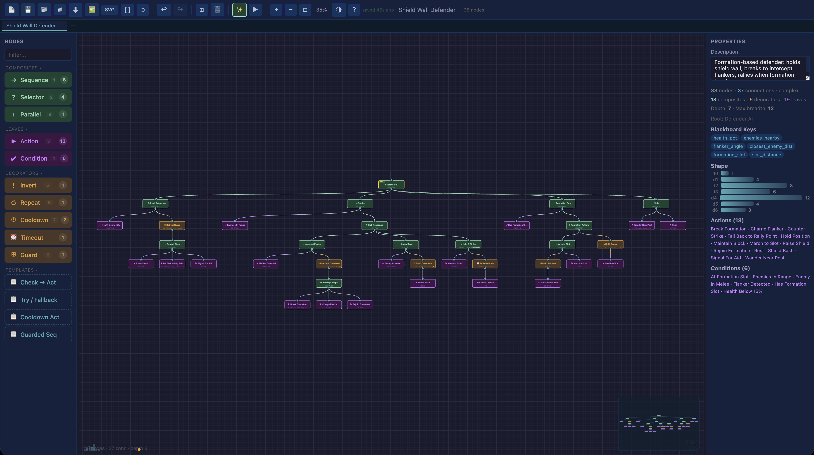

# Behavior Tree Editor

Web-based visual editor for authoring, debugging, and exporting behavior trees. No install, no build step — open `editor/index.html` in a browser or use the [live demo](https://hansvidaure24.github.io/Behavior-Tree-Editor/editor/).




## Features

- **Visual node-graph editor** — drag, connect, multi-select, auto-layout, minimap, 50+ keyboard shortcuts
- **Replay debugger** — load recorded ticks, scrub back in time, heatmap overlay, flow particles, blackboard viewer
- **Git-friendly serialization** — logic and layout stored separately; diffs make sense
- **Cross-engine export** — JSON + runtime adapters for Unity (C#), Unreal (C++), Godot (GDScript)
- **AI-assisted authoring** — describe behavior in plain English via local Ollama, or use regex pattern fallback
- **PWA** — works offline, installable

## Quick Start

```
git clone https://github.com/hansvidaure24/Behavior-Tree-Editor.git
open editor/index.html
```

Or deploy the `editor/` folder to any static host (GitHub Pages, S3, Netlify).

## Engine Integration

Export a `.bt.json` file from the editor, then drop the matching adapter into your project:

| Engine | Adapter | Runtime |
|--------|---------|---------|
| Unity | `adapters/unity/` | Full C# runtime with Blackboard, TickRecorder, MiniJson |
| Unreal | `adapters/unreal/` | C++ headers for all node types |
| Godot | `adapters/godot/` | GDScript runtime for all node types |

## Replay Workflow

1. In your game, use the adapter's `TickRecorder` to capture per-tick node statuses
2. Export as `.replay.json` (see `schemas/replay.schema.json` for format)
3. Drag the file into the editor or use the replay button
4. Scrub the timeline, inspect blackboard state, see heatmap of visit frequency

## Validation

```bash
python validate.py examples/*.bt.json
```

Use in CI or as a pre-commit hook to catch structural errors (cycles, orphans, missing children, invalid types).

## File Format

- `*.bt.json` — tree logic (nodes, connections, parameters). No coordinates.
- `*.layout.json` — node positions. Separate file so layout changes don't pollute logic diffs.
- `*.replay.json` — recorded tick data for the replay debugger.

JSON Schemas in `schemas/`.

## AI Generation (Optional)

If [Ollama](https://ollama.ai) is running locally (`localhost:11434`), the editor will use it to generate trees from plain English descriptions. Without Ollama, a regex pattern fallback handles common behaviors.

## License

MIT
